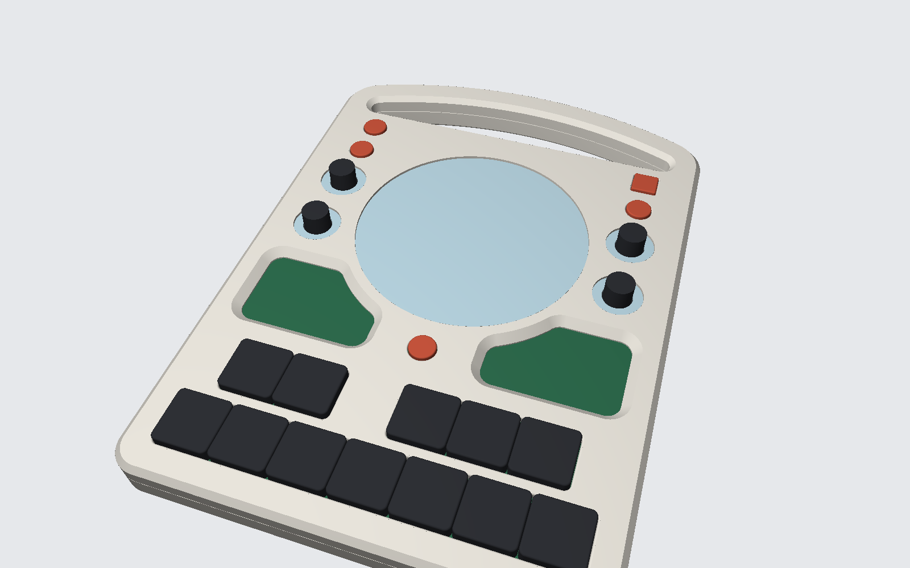
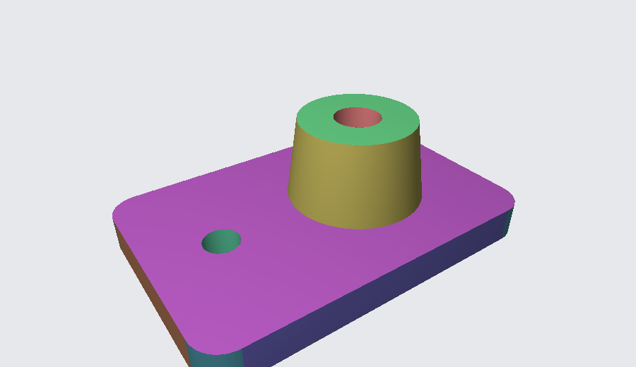
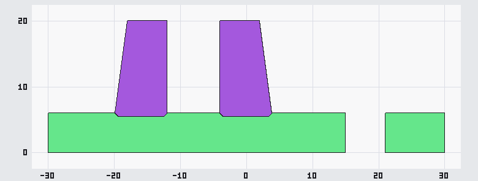

# mk52

mk52 is a small CAD tool in which a part is code. You write OCaml functions that build a solid out of features, save the file, and a page in your browser redraws the part. There is no model file and no history tree to repair: the code is the part.



*A synthesizer's enclosure, designed in mk52: two shells, keys, knobs, buttons and boards, some eighty parts. This is the kernel's own picture of it (`mk52 picture music.assembly paint`).*

It is an implicit kernel: a solid is a function of space, negative inside and positive outside, and everything is read from that one function: the picture, the edges, a mesh, a cut, whether two parts run into each other.

**Where it stands.** mk52 is young and still changing. It has been used on one real design, an enclosure with boards, keys and screws, on one machine: a Mac with Apple silicon. Expect commands and the design language to move.

## What it does

- **Parts as code.** A part is a function that returns a solid. Features are named, nest, and sit in frames, so a feature is moved by moving its frame. Features that belong together are put in a group, which the page opens, shuts, hides and shows as one.
- **A page that follows your editor.** Every time a file is saved the project is built again and the page redraws what is open, on the graphics card. Section cuts the picture open by a plane you slide through the model, and Measure gives the distance between two points you click, with the gap or the angle between their faces.
- **Pictures and cuts without the page.** `mk52 picture` and `mk52 section` are made by the kernel itself, so they work in a terminal, in a script, or for an AI agent.
- **Checks.** `mk52 clash` says which parts of an assembly run into each other, touch, or come too near. `mk52 skins` finds faces of no thickness, where a cut did not go quite far enough. `mk52 extract` finds every edge and corner and flags what looks unintended.
- **Things to take away.** An STL mesh (`mk52 mesh`), and a DXF outline of a flat part such as a circuit board (`mk52 outline`).
- **Bought parts in place.** A STEP or STL file from a maker is shown with the model, where the code puts it.
- **Tools for AI agents.** The same kernel is offered to an agent as tools, so it can look at what it has built.

## Install

mk52 is built from source for now.

**You need:** OCaml 5 and dune (tested with OCaml 5.5 and dune 3.25), and for the page a browser with WebGPU: a recent Chrome, Edge or Safari. It has only been run on macOS.

```sh
git clone https://github.com/Timot05/pointer_mk52.git
cd pointer_mk52
mkdir -p ~/.local/bin         # if it is not there; it must be on your PATH
./mk52 install                # puts the mk52 command there
```

The first run builds the tool, which takes a few seconds. To check it, `dune test` runs its tests.

**Without OCaml.** mk52 can also be packed into a folder that needs nothing installed, because it can carry the OCaml compiler itself (see [A release](#a-release)). No ready-made download is published yet.

## Your first part

```sh
mkdir designs && cd designs
mk52 init                     # this folder is a design folder now
mk52 new lamp base            # a project, lamp/, and its first file, lamp/base.ml
mk52 view lamp.base           # builds it and opens the page on it
```

`lamp/base.ml` starts as a plain block. Replace it with a real part:

```ocaml
(* The base of a lamp: a plate with rounded corners and a hole for the cable, and on it
   a boss for the stem to stand in. Lengths in millimetres. *)
open Mk52

(* An outline drawn in x and y, each side named, pulled from z = 0 up to 6. *)
let plate () =
  let outline =
    Sketch.(
      start (-25., -20.)
      |> line "front" (25., -20.) |> arc "corner" ~centre:(25., -15.) (30., -15.)
      |> line "right" (30., 15.) |> arc "corner" ~centre:(25., 15.) (25., 20.)
      |> line "back" (-25., 20.) |> arc "corner" ~centre:(-25., 15.) (-30., 15.)
      |> line "left" (-30., -15.) |> arc "corner" ~centre:(-25., -15.) (-25., -20.)
      |> close)
  in
  Sketch.extrude ~holes:[ Sketch.circle "cable hole" (18., 0.) 3. ] ~lo:0. ~hi:6. outline

(* A profile drawn in (distance from the axis, height) and turned about z. *)
let boss () =
  Sketch.revolve Sketch.(start (4., -1.) |> line "seat" (12., -1.) |> line "side" (10., 14.) |> line "top" (4., 14.) |> close ~name:"bore")

(* The part: each feature made where it is drawn, the boss then put in its place. *)
let graph () =
  let plate = Graph.feature ~colour:"#d9d4c7" __POS__ "plate" plate in
  let boss = Graph.feature ~colour:"#c8553d" ~frame:(Frame.translate (-8., 0., 6.)) __POS__ "boss" boss in
  Graph.union plate boss
```

Save the file and the page redraws:



Three things in it are the whole idea:

- **A sketch** is an outline of lines and arcs, each side with a name, that is pulled straight (`Sketch.extrude`) or turned about an axis (`Sketch.revolve`). Its sides become the solid's faces, by those names.
- **A feature** (`Graph.feature`) is a named step of the part. It can have a colour and a frame: the boss is drawn about its own origin and then put at (-8, 0, 6). Features made inside a feature are listed under it. **A group** (`Graph.group`) is a name around features that builds no solid of its own, so its function may return anything: `Graph.group __POS__ "holes" (fun () -> List.map hole places)` gives the list of holes back, and lists them under "holes".
- **Solids combine** with `Graph.union`, `Graph.intersection` and `Graph.subtract`.

Every function that takes `()` and returns a solid can be looked at on its own, so `lamp.base.plate` and `lamp.base.boss` are models too, beside `lamp.base` itself.

To see inside it, cut it:

```sh
mk52 section lamp.base y=0
```



The boss starts 1 mm inside the plate on purpose. Where two faces lie on exactly the same surface, a cut that ends level with another face for one, they leave a skin of no thickness. mk52 does not draw such a skin, and `mk52 skins` finds them and names the two faces; but it is cleaner to have one face go a little further than the other, as here.

## How a design is laid out

```
designs/                  a design folder (mk52 init)
  lamp/                   a project: every .ml file in it is compiled together
    base.ml               the module Base to the other files, with no import
    shade.ml
  _mk52/                  what the tool makes: pictures, meshes, outlines
```

A model is named `<project>.<file>.<function>`, or `<project>.<file>` for a file's `graph` or its only function. Lengths are millimetres. A model must lie within 10 m of the origin.

What there is to build with is the kernel's own code, which a design folder reaches through its link `mk52/`, and which is written to be read:

| Module | What it gives |
|---|---|
| `Sketch` (`lib/sketch.ml`) | outlines of lines and arcs, pulled, turned, or lofted through sections; holes as loops of their own; chamfers |
| `Solid` (`lib/solid.ml`) | plane, sphere, cylinder, cone, torus |
| `Graph` (`lib/graph.ml`) | union, intersection, subtract, offset, rounded unions and intersections (fillets), features and groups |
| `Frame` (`lib/frame.ml`) | where a feature sits: translate, rotate, and chains of them |
| `Asset` (`lib/asset.ml`) | a STEP or STL file shown with the model |
| `Clash` (`lib/clash.ml`) | `Clash.allow "a part" "another"`: these two are meant to touch |

`models/bracket.ml` is a worked example of a part made of sketches.

## Commands

| Command | What it does |
|---|---|
| `mk52 init` | makes the folder a design folder: a dune project, a link `mk52` to the tool, and `.mcp.json` for an agent |
| `mk52 new <project> <file>` | a new file with one function, a block to start from; the project's folder and build file if they are not there |
| `mk52 open` | serves the page here if it is not served yet, and opens it in the browser (`$BROWSER`, or the system's own) |
| `mk52 view <model>` | builds a model and shows it in the page, in front; opens the page if none is open |
| `mk52 models` | the projects here and their functions; `mk52 models shapes` lists the tool's own small shapes |
| `mk52 close <model> ...` | closes those models in the page |
| `mk52 status`, `mk52 stop` | whether the page is served, where, and what is open; stops serving it |
| `mk52 picture <model> [...]` | a picture made by the kernel, with no page and no graphics card: a PNG whose path is printed. `yaw=` `pitch=` `distance=` `target=x,y,z` `edges` `mesh` `paint` (each part in its own colour) `size=800x600` `out=` |
| `mk52 extract <model> [32\|64\|128]` | its edges and corners, printed with every flag, and drawn in the page if the model is open |
| `mk52 outline <model> [out=file.dxf]` | the outline of a flat part, a board's: the edges round its top, holes too, as the lines, arcs and circles they are, in a DXF file in mm |
| `mk52 skins <model>` | its faces of no thickness: where two faces lie on one surface with air on both sides, each with the two faces and where |
| `mk52 clash <model> [other] [gap=0.3]` | whether its parts run into each other, touch, or are nearer than the gap: every pair, and its bought parts against them; or its parts against another model's. What a design says is meant (`Clash.allow`) is listed apart |
| `mk52 section <model> z=<n>` | a cut through it where that coordinate (`x=`, `y=` or `z=`) is that number: what is solid, each part in a colour of its own, with a scale; the other two `from:to` to look closer; `text` for the cut as letters |
| `mk52 mesh <model> tol=0.05` | its surface as triangles attached to its creases and corners, none further than that from it and no more than that takes: a binary STL file of one solid, for a slicer, what the mesh is like, and a picture |
| `mk52 mesh <model> [cells] [raw]` | the same in cells all of one size (32 to 256 across the model) with even triangles |
| `mk52 brief <model>` | what an agent working on that function is told |
| `mk52 mcp` | the kernel and the page as tools for an agent |

## For AI agents

`mk52 init` writes a `.mcp.json` in the design folder, which offers the kernel to an agent as tools: `picture`, `section`, `clash`, `skins`, `kernel_probe` (the solid's value at points), `kernel_extract`, `viewer_state` (what you have picked, cut and measured in the page) and `feature_brief` (how to work on one function). An agent works in your editor's files and looks at the result through these, without the page.

## Two ways to build a design

A design's code is OCaml. The command turns it into models in one of two ways, and says nothing different either way.

- **By dune.** The project is compiled once into a program of its own. This needs OCaml and dune installed, and the tool's source (a design folder reaches it through its link `mk52`). It is what an editor's OCaml support reads, and it is what is used wherever it can be.
- **By the builder.** `embed/embed.ml` carries the OCaml compiler. It reads a project's files, checks and loads them, and builds a function by name; the command keeps it running with the project loaded and starts it again when a file has changed. This needs nothing installed. A model takes a little longer to build (the code runs as bytecode), and nothing is compiled ahead.

`MK52_BUILDER=dune` or `MK52_BUILDER=carried` says which; unsaid, it is dune where dune can do it, and the builder otherwise. Both build the same solids: the same faces and features, and fields that agree to rounding.

## A release

```sh
tools/release.sh              # _release/mk52-<system>-<machine>/
```

makes a folder that is the whole tool: `bin/mk52`, `bin/mk52-build` (the builder), `interfaces/` (the kernel's and the standard library's compiled interfaces, which the builder checks a design's code against), `web/view.html`, and the kernel's code to read. Put its `bin/` on the path, and `mk52 init` in an empty folder makes a design folder there: marked by the file `mk52.design`, with a link `mk52` to the tool, and every folder with `.ml` files in it a project. No OCaml is needed where it is used.

On macOS the builder's one outside library (zstd, which OCaml's bytecode runtime is linked to) is carried in `bin/` beside it. The script has only been run on macOS.

## Limits

- **One machine so far.** macOS on Apple silicon. Linux and Windows are untried, and so are other graphics cards.
- **Still moving.** There is no version yet and nothing promises that a design written today builds unchanged next month.
- **Bought parts are only shown.** A STEP or STL file is not part of the solid: it cannot be cut or joined, and the clash check holds it against the designed parts by the points of its triangles only.
- **The mesh is to a tolerance you give** (`tol=`), but what is thinner than that tolerance may be lost: a wall that thins to nothing, two faces all but on one another. The report says where, if anywhere, a triangle is further off than was asked.
- **The clash check is slow on large assemblies:** about a minute for eighty parts.
- **No drawings.** There are pictures, cuts, meshes and a board's outline, but no dimensioned 2D drawings and no STEP export.

## How it works, and working on mk52 itself

A model's code builds a graph of pieces and choices; the kernel compiles it to one evaluator and to a shader, and the page marches a ray a pixel through that shader. [NOTES.md](NOTES.md) has the rest: how the page draws, what was measured on the way and what was learned from it, how the parts of the tool meet, and what each file holds.

mk52 grew out of an earlier kernel of the same author's, `pointer_mk49`, which is not published; where the notes mention it, that is what they mean.

## Licence

MIT: see `LICENSE`.
